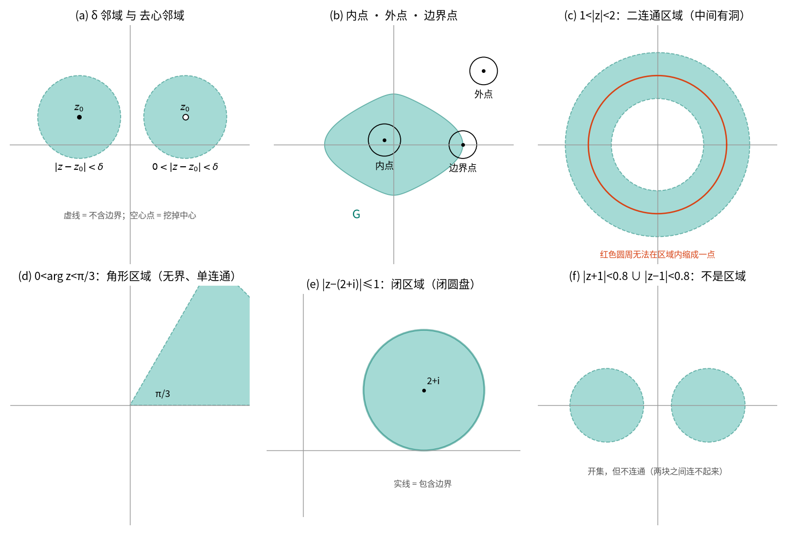
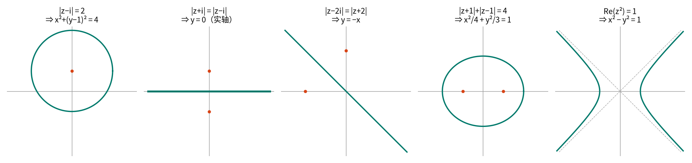
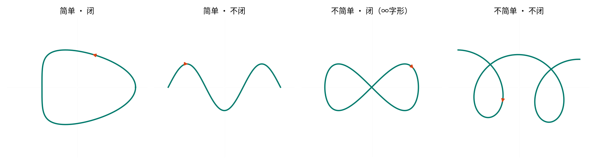
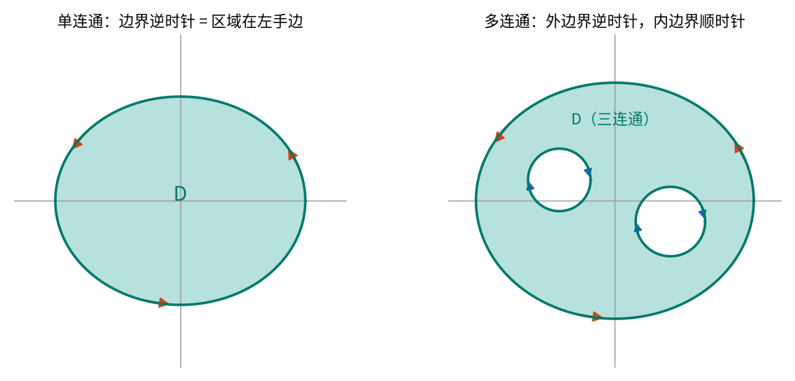

# 第 1 章 复数与复变函数

!!! tip "本章目标"

    1. 把复数看成**平面上的点 / 箭头**，熟练在代数式、三角式、指数式之间转换，会按象限正确求**主辐角** $\arg z$；
    2. 理解“**乘法 = 模相乘 + 辐角相加**”的几何意义，用它快速算乘幂（棣莫弗公式）和 $n$ 次方根；
    3. 会用复数描述平面点集和曲线：邻域、开集、**区域**、单连通 / 多连通、简单闭曲线及其正向；
    4. 知道无穷远点 $\infty$ 与复球面是什么；
    5. 理解复变函数 $w=f(z)$ 就是 $z$ 平面到 $w$ 平面的**映射**，会拆成 $u(x,y)+iv(x,y)$，会判断极限是否存在、函数是否连续。

本章是全课的“地基”。它不难，但后面每一章都在反复使用这里的几何直觉：第 2 章的 C-R 方程来自“极限与方向无关”，第 3 章的柯西定理依赖“单连通”，第 5 章要用“无穷远点”，第 6 章的共形映射就是本章“映射”观点的延续。

??? note "附：虚数史话（选读）"

    - 1545 年，卡尔丹在《大术》中求“两数之和为 10、积为 40”，得到 $5+\sqrt{-15}$ 与 $5-\sqrt{-15}$，称之为“虚构的量”。
    - 1637 年，笛卡尔在《几何学》中把这种量称为“虚数”（imaginary）。
    - 1722 年前后，棣莫弗（de Moivre）给出 $(\cos\theta+i\sin\theta)^n=\cos n\theta+i\sin n\theta$；1748 年欧拉给出 $e^{ix}=\cos x+i\sin x$；1777 年欧拉首次用 $i$ 表示 $\sqrt{-1}$。
    - 1797–1799 年，高斯证明**代数基本定理**（$n$ 次多项式在复数域恰有 $n$ 个根），并给出复数的几何表示——复数从此“有了地方住”：平面。
    - 19 世纪，柯西、黎曼、魏尔斯特拉斯奠定了复变函数论。

---

## 1.1 复数及其运算

### 1.1.1 复数的定义

设 $x,y$ 是任意实数，形如

$$z = x + iy \qquad (\text{也写作 } z = x + yi)$$

的数称为**复数**，其中 $i$ 是**虚数单位**，满足 $i^2=-1$。

- $x=\operatorname{Re} z$ 称为**实部**，$y=\operatorname{Im} z$ 称为**虚部**（注意：虚部是实数 $y$，不是 $iy$）；
- $x=0,\ y\neq 0$ 时 $z=iy$ 称为**纯虚数**；$y=0$ 时 $z=x$ 就是实数——实数是复数的特例。

**相等。** $z_1=x_1+iy_1$ 与 $z_2=x_2+iy_2$ 相等 $\iff x_1=x_2$ 且 $y_1=y_2$。特别地 $z=0 \iff x=y=0$。

!!! warning "易错点：复数不能比较大小"

    两个（虚部不为零的）复数之间只有“相等 / 不相等”，**没有大于小于**。原因：如果能定义一个和加法、乘法相容的顺序，那么 $i>0$ 或 $i<0$ 必居其一；不论哪种，都有 $i\cdot i>0$，即 $-1>0$，矛盾。

    所以 “$z_1 < z_2$” 是无意义的写法，但 $|z_1|<|z_2|$、$\operatorname{Re}z_1<\operatorname{Re}z_2$ 都没问题（它们是实数）。

### 1.1.2 四则运算

设 $z_1=x_1+iy_1,\ z_2=x_2+iy_2$。

- **加减**：实部虚部分别加减，$z_1\pm z_2=(x_1\pm x_2)+i(y_1\pm y_2)$。
- **乘法**：按多项式展开，再用 $i^2=-1$：

    $$z_1z_2=(x_1x_2-y_1y_2)+i(x_1y_2+x_2y_1).$$

- **除法**：若 $z_2\neq 0$，满足 $z_2 z = z_1$ 的 $z$ 称为商 $z_1/z_2$。计算时**分子分母同乘分母的共轭**（见 1.1.3）：

    $$\frac{z_1}{z_2}=\frac{z_1\overline{z_2}}{z_2\overline{z_2}}=\frac{x_1x_2+y_1y_2}{x_2^2+y_2^2}+i\,\frac{x_2y_1-x_1y_2}{x_2^2+y_2^2}.$$

运算满足交换律、结合律、分配律，和实数完全一样。

!!! example "例题 1.1"

    计算 $\dfrac{(1+2i)(3-i)}{1+i}$。

    **解。** 先算分子：$(1+2i)(3-i)=3-i+6i-2i^2=3+5i+2=5+5i$。
    再除：$\dfrac{5+5i}{1+i}=\dfrac{5(1+i)}{1+i}=5$。

    检查：结果是实数。这并不奇怪——后面学了“辐角相加减”就能一眼看出：$\arg(1+2i)+\arg(3-i)=\arctan 2-\arctan\frac13=\frac{\pi}{4}=\arg(1+i)$，辐角正好抵消。

### 1.1.3 共轭复数

$z=x+iy$ 的**共轭复数**是 $\bar z = x-iy$。几何上：**关于实轴的镜像**。

!!! success "关键公式：共轭的性质"

    $$\overline{\overline{z}}=z,\qquad \overline{z_1\pm z_2}=\overline{z_1}\pm\overline{z_2},\qquad \overline{z_1z_2}=\overline{z_1}\ \overline{z_2},\qquad \overline{\left(\frac{z_1}{z_2}\right)}=\frac{\overline{z_1}}{\overline{z_2}}$$

    $$z\bar z=x^2+y^2=|z|^2,\qquad \operatorname{Re}z=\frac{z+\bar z}{2},\qquad \operatorname{Im}z=\frac{z-\bar z}{2i}.$$

    口诀：**共轭可以“穿过”加减乘除**；**乘以自己的共轭得到模的平方（一个非负实数）**。

!!! example "例题 1.2（教材例 1.1）"

    证明 $z_1\overline{z_2}+\overline{z_1}z_2 = 2\operatorname{Re}(z_1\overline{z_2})$。

    **证。** 记 $w=z_1\overline{z_2}$，则 $\bar w=\overline{z_1}\,\overline{\overline{z_2}}=\overline{z_1}z_2$。于是左边 $=w+\bar w=2\operatorname{Re}w=2\operatorname{Re}(z_1\overline{z_2})$。$\blacksquare$

    这个式子马上会用来证明三角不等式。

---

## 1.2 复数的几种表示

### 1.2.1 复平面：复数 = 点 = 向量

在平面上建立直角坐标系，让复数 $z=x+iy$ 对应点 $(x,y)$，全体复数就和平面上的点一一对应。这个平面称为**复平面**（$z$ 平面），$x$ 轴叫**实轴**，$y$ 轴叫**虚轴**。

再进一步，把 $z$ 看成**从原点指向 $(x,y)$ 的向量**。于是：

- 复数加减法 = 向量加减法（平行四边形法则 / 三角形法则）；
- $z_1-z_2$ 是从 $z_2$ 指向 $z_1$ 的向量，$|z_1-z_2|$ 就是**两点间距离**——这一点在描述圆、邻域时天天用。

!!! info "直觉"

    以后看到“复数”，脑子里要同时出现三样东西：一个**点**、一根从原点出发的**箭头**、一对实数 $(x,y)$。代数运算只是在操作这根箭头。

### 1.2.2 模与辐角

- **模**：箭头的长度 $|z|=r=\sqrt{x^2+y^2}\ \ (\ge 0)$。
- **辐角**：$z\neq 0$ 时，箭头与正实轴的夹角 $\theta$（逆时针为正）称为辐角，记作 $\operatorname{Arg} z$。

**辐角是多值的。** 箭头转一整圈回到原处，所以辐角相互之间可以差 $2k\pi$：例如 $z=-1+i$，$|z|=\sqrt2$，

$$\operatorname{Arg}z=\frac{3\pi}{4}+2k\pi,\qquad k=0,\pm1,\pm2,\cdots$$

**主辐角。** 在所有辐角中取满足 $-\pi<\theta_0\le\pi$ 的那一个，称为**主辐角**，记作 $\arg z$（小写）。于是

$$\operatorname{Arg}z=\arg z+2k\pi,\qquad k\in\mathbb Z.$$

$z=0$ 的模为 0，**辐角无意义**。

!!! success "关键公式：按象限求主辐角"

    设 $z=x+iy\neq 0$，记 $\alpha=\arctan\dfrac{y}{x}\in\left(-\dfrac{\pi}{2},\dfrac{\pi}{2}\right)$：

    | $z$ 的位置 | $\arg z$ |
    |---|---|
    | 第一、四象限及正实轴（$x>0$） | $\alpha$ |
    | 第二象限及负实轴（$x<0,\ y\ge 0$） | $\alpha+\pi$ |
    | 第三象限（$x<0,\ y<0$） | $\alpha-\pi$ |
    | 正虚轴（$x=0,\ y>0$） | $\pi/2$ |
    | 负虚轴（$x=0,\ y<0$） | $-\pi/2$ |

!!! warning "易错点：$\arg z \ne \arctan(y/x)$"

    $\arctan$ 的值域只有 $(-\pi/2,\pi/2)$，只能覆盖右半平面。$z=-1-i$ 和 $z=1+i$ 的 $y/x$ 都是 1，但前者 $\arg z=-\frac{3\pi}{4}$，后者 $\frac{\pi}{4}$。**先画图看象限，再套公式**——这是本章丢分最多的地方。

!!! example "例题 1.3"

    求 $z=\dfrac{2i}{1-i}+\dfrac{2(1-i)}{i}$ 的模与主辐角。

    **解。** 先化成代数式：

    $$\frac{2i}{1-i}=\frac{2i(1+i)}{(1-i)(1+i)}=\frac{2i-2}{2}=-1+i,\qquad \frac{2(1-i)}{i}=\frac{2(1-i)(-i)}{i\cdot(-i)}=-2i+2i^2=-2-2i,$$

    所以 $z=-3-i$，位于**第三象限**。

    $$|z|=\sqrt{(-3)^2+(-1)^2}=\sqrt{10},\qquad \arg z=\arctan\frac{-1}{-3}-\pi=\arctan\frac13-\pi .$$

### 1.2.3 三角式与指数式

由 $x=r\cos\theta,\ y=r\sin\theta$ 得到**三角表示式**

$$z=r(\cos\theta+i\sin\theta).$$

再利用**欧拉公式**

$$\boxed{\,e^{i\theta}=\cos\theta+i\sin\theta\,}$$

得到**指数表示式** $z=re^{i\theta}$。这里 $\theta$ 可以取任意一个辐角，习惯上取主辐角。

!!! info "为什么 $e^{i\theta}=\cos\theta+i\sin\theta$？（两个角度的直觉）"

    1. **级数角度**：把 $x=i\theta$ 代入 $e^x=1+x+\frac{x^2}{2!}+\frac{x^3}{3!}+\cdots$，利用 $i^2=-1,\ i^3=-i,\ i^4=1$，偶次项凑成 $\cos\theta$ 的级数，奇次项凑成 $i\sin\theta$ 的级数。（第 2 章会把 $e^z$ 正式定义出来，第 4 章会严格讲级数。）
    2. **运动角度**：$\frac{d}{d\theta}e^{i\theta}=ie^{i\theta}$——“速度 = 位置乘以 $i$” = 速度方向永远垂直于位置向量、长度相同。这正是单位圆上的匀速圆周运动，$\theta$ 就是转过的弧长。

    在电路课里，相量 $\dot U=Ue^{j\varphi}$ 用的就是这个式子。

!!! example "例题 1.4"

    把 $z=-\sqrt{12}-2i$ 化为三角式和指数式。

    **解。** $|z|=\sqrt{12+4}=4$。$z$ 在第三象限，

    $$\arg z=\arctan\frac{-2}{-\sqrt{12}}-\pi=\arctan\frac{1}{\sqrt3}-\pi=\frac{\pi}{6}-\pi=-\frac{5\pi}{6}.$$

    故 $z=4\left[\cos\left(-\frac{5\pi}{6}\right)+i\sin\left(-\frac{5\pi}{6}\right)\right]=4e^{-\frac{5\pi}{6}i}$。

    （写成 $4e^{\frac{7\pi}{6}i}$ 也对——它们只差 $2\pi$；但若题目要求“主辐角”，必须是 $-\frac{5\pi}{6}$。）

**常用的“简单”复数的指数形式**（建议背熟，画在单位圆上记）：

$$1=e^{0},\quad i=e^{\frac{\pi}{2}i},\quad -1=e^{\pi i},\quad -i=e^{-\frac{\pi}{2}i},\quad 1+i=\sqrt2e^{\frac{\pi}{4}i},\quad 1-i=\sqrt2e^{-\frac{\pi}{4}i},\quad \tfrac12+\tfrac{\sqrt3}{2}i=e^{\frac{\pi}{3}i},\quad e^{2k\pi i}=1 .$$

### 1.2.4 乘法与除法的几何意义：旋转 + 伸缩

设 $z_1=r_1e^{i\theta_1},\ z_2=r_2e^{i\theta_2}$，由指数运算法则：

!!! success "关键公式：乘除 = 模乘除 + 辐角加减"

    $$z_1z_2=r_1r_2\,e^{i(\theta_1+\theta_2)},\qquad \frac{z_1}{z_2}=\frac{r_1}{r_2}\,e^{i(\theta_1-\theta_2)}\quad(z_2\ne0).$$

    即

    $$|z_1z_2|=|z_1||z_2|,\quad \operatorname{Arg}(z_1z_2)=\operatorname{Arg}z_1+\operatorname{Arg}z_2;\qquad \left|\frac{z_1}{z_2}\right|=\frac{|z_1|}{|z_2|},\quad \operatorname{Arg}\frac{z_1}{z_2}=\operatorname{Arg}z_1-\operatorname{Arg}z_2.$$

**几何意义：乘以 $z_2$ = 把箭头 $z_1$ 逆时针转 $\theta_2$，再把长度乘 $r_2$。** 特别地，乘以 $i=e^{i\pi/2}$ 就是逆时针转 $90^\circ$；$i^2=-1$ 就是“转两次 $90^\circ$ = 掉头”。下面的动画把这一点演示出来：

<figure class="video" markdown>
<video controls preload="metadata" width="100%" poster="assets/posters/C1_VectorAndMultiply.jpg">
<source src="assets/videos/C1_VectorAndMultiply.mp4" type="video/mp4">
</video>
<figcaption>动画 1-1　复数 = 箭头；三种表示式；乘以 w = 1+i 是“转 π/4 再拉长 √2 倍”；乘以 i 是转 90°。</figcaption>
</figure>

!!! warning "易错点：辐角等式是“集合意义下”的"

    $\operatorname{Arg}(z_1z_2)=\operatorname{Arg}z_1+\operatorname{Arg}z_2$ 的意思是：从左右两个**集合**里各取一个元素相加，得到的仍在左边集合中；反之亦然。它对**主辐角不成立**：$z_1=z_2=-1$ 时 $\arg z_1+\arg z_2=2\pi$，而 $\arg(z_1z_2)=\arg 1=0$。

    同理，$\operatorname{Arg}(z^2)\ne 2\operatorname{Arg}z$（作为集合）：前者是 $2\arg z+2k\pi$，后者是 $2\arg z+4k\pi$，后者“少了一半”。

!!! example "例题 1.5"

    计算 $\dfrac{i}{1-i}$。

    **解（指数式）。** $i=e^{\frac{\pi}{2}i}$，$1-i=\sqrt2e^{-\frac{\pi}{4}i}$，所以

    $$\frac{i}{1-i}=\frac{1}{\sqrt2}e^{\left(\frac{\pi}{2}+\frac{\pi}{4}\right)i}=\frac{1}{\sqrt2}e^{\frac{3\pi}{4}i}=\frac{1}{\sqrt2}\left(-\frac{\sqrt2}{2}+\frac{\sqrt2}{2}i\right)=-\frac12+\frac12 i.$$

    （用代数式验证：$\frac{i(1+i)}{2}=\frac{-1+i}{2}$。✓）

### 1.2.5 乘幂：棣莫弗公式

$n$ 个 $z$ 相乘记为 $z^n$。由乘法规则立即得到：

!!! success "关键公式：棣莫弗（de Moivre）公式"

    $$z^n=\left(re^{i\theta}\right)^n=r^ne^{in\theta},\qquad (\cos\theta+i\sin\theta)^n=\cos n\theta+i\sin n\theta.$$

    规定 $z^{-n}=1/z^n$ 后，对负整数 $n$ 也成立。**模乘方，辐角乘 $n$。**

!!! example "例题 1.6"

    (1) 计算 $(1+i)^{10}$；(2) 计算 $\left(\frac12+\frac{\sqrt3}{2}i\right)^3$；(3) 用棣莫弗公式推出 $\cos3\theta$ 的表达式。

    **解。** (1) $1+i=\sqrt2e^{\frac{\pi}{4}i}$，$(1+i)^{10}=(\sqrt2)^{10}e^{\frac{10\pi}{4}i}=32e^{\frac{5\pi}{2}i}=32e^{\frac{\pi}{2}i}=32i$。

    (2) $\frac12+\frac{\sqrt3}{2}i=e^{\frac{\pi}{3}i}$，立方得 $e^{\pi i}=-1$。同理 $\left(\frac12-\frac{\sqrt3}{2}i\right)^3=e^{-\pi i}=-1$，而 $(-1)^3=-1$。也就是说 **$-1$ 有三个立方根**——这引出了方根。

    (3) $(\cos\theta+i\sin\theta)^3=\cos3\theta+i\sin3\theta$。左边按二项式展开，取实部：

    $$\cos3\theta=\cos^3\theta-3\cos\theta\sin^2\theta=4\cos^3\theta-3\cos\theta .$$

    这就是“用复数推三角恒等式”的标准套路，比记公式可靠。

### 1.2.6 方根：$n$ 个根均匀分布在圆周上

求所有满足 $w^n=z$ 的复数 $w$，称为求 $z$ 的 **$n$ 次方根**，记作 $w=\sqrt[n]{z}$ 或 $z^{1/n}$。

**推导。** 设 $z=re^{i\theta}$，$w=\rho e^{i\varphi}$。由 $w^n=\rho^ne^{in\varphi}=re^{i\theta}$：

- 模相等：$\rho^n=r \Rightarrow \rho=\sqrt[n]{r}$（正实数的算术根）；
- 辐角**相差 $2k\pi$**（而不是必须相等！）：$n\varphi=\theta+2k\pi\Rightarrow \varphi=\dfrac{\theta+2k\pi}{n}$。

!!! success "关键公式：$n$ 次方根"

    $$w_k=\sqrt[n]{z}=\sqrt[n]{r}\;e^{\,i\frac{\theta+2k\pi}{n}},\qquad k=0,1,\cdots,n-1 .$$

    $k$ 取 $n,n+1,\dots$ 时又重复回来，所以**恰好 $n$ 个不同的根**。它们均匀分布在以原点为圆心、半径 $\sqrt[n]{r}$ 的圆周上，相邻两根夹角 $\frac{2\pi}{n}$，构成正 $n$ 边形的顶点。

**两种求法：** ① 直接套公式；② 先找到一个容易的根 $w_0$，其余的根 = $w_0$ 依次乘以 $e^{2\pi i/n}$（转 $\frac{2\pi}{n}$）。

<figure class="video" markdown>
<video controls preload="metadata" width="100%" poster="assets/posters/C1_PowersAndRoots.jpg">
<source src="assets/videos/C1_PowersAndRoots.mp4" type="video/mp4">
</video>
<figcaption>动画 1-2　乘幂沿螺线向外转；zⁿ = 1 的 n 个根构成正 n 边形；z 绕原点一圈时，∛z 的三个值依次轮换——这就是“多值”的来源。</figcaption>
</figure>

!!! example "例题 1.7"

    (1) 求 $\sqrt[3]{-8}$；(2) 解方程 $z^3-1=0$。

    **解。** (1) $-8=8e^{\pi i}$，所以 $\sqrt[3]{-8}=2e^{i\frac{\pi+2k\pi}{3}},\ k=0,1,2$：

    $$w_0=2e^{\frac{\pi}{3}i}=1+\sqrt3i,\qquad w_1=2e^{\pi i}=-2,\qquad w_2=2e^{\frac{5\pi}{3}i}=1-\sqrt3i .$$

    (2) $z^3=1=e^{0i}$，$z=e^{\frac{2k\pi}{3}i}$：$\ 1,\ \ -\frac12+\frac{\sqrt3}{2}i,\ \ -\frac12-\frac{\sqrt3}{2}i$。

    （方法②：显然 $-2$ 是 $\sqrt[3]{-8}$ 的一个根，乘以 $e^{\pm\frac{2\pi}{3}i}$ 得另外两个。）

!!! warning "易错点"

    - 实数范围里 $\sqrt[3]{-8}=-2$ 只有一个；**复数范围里有三个**。考试题“求 $\sqrt[n]{z}$”必须写出全部 $n$ 个。
    - 单位根有个漂亮性质：$\sum_{k=0}^{n-1}e^{2k\pi i/n}=0$（$n\ge2$）——正多边形的顶点向量之和为零。DFT 的正交性就来自它。

!!! note "前后联系"

    动画最后一段演示了：$z$ 沿圆周绕原点**一整圈**，$\sqrt[3]{z}$ 只转了 $\frac{1}{3}$ 圈，从一个根“滑”到了另一个根。这就是为什么第 2 章讲 $\sqrt[n]{z}$、$\operatorname{Ln}z$ 时，必须在平面上“剪一刀”（**支割线**）才能得到单值的分支。

### 1.2.7 几个常用关系（不等式）

!!! success "关键公式"

    1. $|\operatorname{Re}z|\le|z|,\quad |\operatorname{Im}z|\le|z|,\quad |z|\le|\operatorname{Re}z|+|\operatorname{Im}z|$；
    2. **三角不等式**：$\big||z_1|-|z_2|\big|\le|z_1\pm z_2|\le|z_1|+|z_2|$；
    3. $|\bar z|=|z|$，$\arg\bar z=-\arg z$（$z$ 不在负实轴和原点上），$|z|^2=z\bar z$。

**三角不等式的证明**（复数证明不等式的标准手法：**先平方，化成共轭**）：

$$\begin{aligned}
|z_1+z_2|^2&=(z_1+z_2)\overline{(z_1+z_2)}=(z_1+z_2)(\overline{z_1}+\overline{z_2})\\
&=|z_1|^2+|z_2|^2+z_1\overline{z_2}+\overline{z_1}z_2=|z_1|^2+|z_2|^2+2\operatorname{Re}(z_1\overline{z_2})\\
&\le|z_1|^2+|z_2|^2+2|z_1\overline{z_2}|=(|z_1|+|z_2|)^2 .
\end{aligned}$$

几何意义：**三角形两边之和不小于第三边**（$z_1,\ z_2,\ z_1+z_2$ 构成三角形的三条边）。

---

## 1.3 平面点集的一般概念

复变函数的定义域通常是“区域”。这一节把高数里学过的平面点集概念用复数语言重新说一遍，并引入后面最重要的两个概念：**单连通**与**闭曲线的正向**。

### 1.3.1 邻域、内点、开集

- **$\delta$ 邻域**：$\{z:|z-z_0|<\delta\}$——以 $z_0$ 为圆心、$\delta$ 为半径的开圆盘。
- **去心邻域**：$\{z:0<|z-z_0|<\delta\}$——挖掉圆心。（极限、孤立奇点都在去心邻域上讨论。）

对点集 $G$ 和点 $z_0$：

- **内点**：$z_0\in G$，且存在一个邻域完全含于 $G$；
- **外点**：$z_0\notin G$，且存在一个邻域与 $G$ 完全不相交；
- **边界点**：$z_0$ 的**任意**邻域中既有 $G$ 的点、又有不属于 $G$ 的点（$z_0$ 本身可以属于也可以不属于 $G$）。所有边界点组成 $G$ 的**边界**。

**开集**：每个点都是内点；**闭集**：边界点全都属于它。**有界集**：能被某个以原点为圆心的圆盘包住。



### 1.3.2 区域

!!! definition "定义：区域"

    平面点集 $D$ 称为**区域**，如果

    1. $D$ 是**开集**；
    2. $D$ 是**连通**的：$D$ 中任何两点都可以用一条完全属于 $D$ 的折线连起来。

    区域连同它的边界称为**闭区域**，记作 $\overline D$。

    一句话：**区域 = 连通的开集**。

**简单闭曲线与内外部。** 一条不自交的闭曲线（见 1.3.4）把整个平面分成两个区域（若尔当定理）：有界的叫**内部**，无界的叫**外部**。

!!! definition "定义：单连通域 / 多连通域"

    区域 $D$ 称为**单连通域**，如果 $D$ 内**任意**一条简单闭曲线的内部仍全部属于 $D$；否则称为**多连通域**。

    直观地说：**单连通 = 没有洞**；区域内任意一个橡皮筋圈都能在区域里收缩成一点。圆环 $1<|z|<2$ 中间有洞，绕洞一圈的圆周收缩不了，所以是**二连通域**；挖掉两个洞就是三连通域。

!!! note "前后联系"

    “单连通”是第 3 章**柯西积分定理**的前提：在单连通域内解析的函数，沿任意闭曲线积分为 0。一旦区域有洞（多连通），积分就可能不为 0——第 5 章的留数正是在“数洞里有什么”。

!!! example "例题 1.8：描述下列点集"

    | 不等式 | 几何意义 | 类型 |
    |---|---|---|
    | $\operatorname{Re}z>0$ | 右半平面 | 区域，无界，单连通 |
    | $\lvert z-(2+i)\rvert\le1$ | 以 $2+i$ 为心、半径 1 的闭圆盘 | 闭区域，有界 |
    | $0<\arg z<\frac{\pi}{3}$ | 从原点出发、夹角 $\frac{\pi}{3}$ 的角形 | 区域，无界，单连通 |
    | $1<\lvert z\rvert<2$ | 圆环 | 区域，有界，**二连通** |
    | $0<\lvert z-1\rvert<2$ | 去心圆盘 | 区域，有界，**二连通**（挖掉一个点也算洞！） |

!!! warning "易错点"

    - **挖掉一个点也算一个“洞”**：$0<|z|<1$ 是二连通域。绕原点的小圆周无法在区域内收缩成一点（会碰到被挖掉的原点）。
    - 区域必须是**开集**，所以 $|z|\le1$ 不是区域（是闭区域）；两个不相交的圆盘之并不连通，也不是区域。

### 1.3.3 平面曲线的复数方程

同一条曲线，可以用直角坐标方程 $F(x,y)=0$ 描述，也可以用复数方程 $f(z)=0$ 描述。互相转换的桥梁是

$$z=x+iy\quad\Longleftrightarrow\quad x=\frac{z+\bar z}{2},\quad y=\frac{z-\bar z}{2i}.$$

- **理解方程**（$f(z)=0\to F(x,y)=0$）：把 $z=x+iy$ 代进去，或者直接用几何意义（$|z-a|$ 是到 $a$ 的距离）；
- **建立方程**（$F(x,y)=0\to f(z)=0$）：把 $x,y$ 换成 $z,\bar z$。

!!! example "例题 1.9：下列方程表示什么曲线？"

    1. $|z-i|=2$：到 $i$ 距离为 2 ⇒ 圆 $x^2+(y-1)^2=4$。
    2. $|z+i|=|z-i|$：到 $-i$ 和 $i$ 距离相等 ⇒ 两点连线的垂直平分线，即实轴 $y=0$。
    3. $|z-2i|=|z+2|$：到 $2i$ 与 $-2$ 等距 ⇒ 垂直平分线 $y=-x$。
    4. $|z+1|+|z-1|=4$：到两焦点 $\pm1$ 距离之和为 4 ⇒ 椭圆，$a=2,\ c=1,\ b^2=3$：$\dfrac{x^2}{4}+\dfrac{y^2}{3}=1$。
    5. $\operatorname{Re}(z^2)=1$：$z^2=(x^2-y^2)+2xyi$ ⇒ 双曲线 $x^2-y^2=1$。

    

    **技巧**：看到 $|z-a|$ 立刻想“到 $a$ 的距离”，大多数题不用代入 $x,y$ 就能看出答案。

!!! success "关键公式：圆的复数方程（第 6 章要用）"

    以 $z_0$ 为心、$R$ 为半径的圆：$|z-z_0|=R$，展开 $(z-z_0)(\bar z-\bar z_0)=R^2$ 得

    $$z\bar z-\bar z_0z-z_0\bar z+|z_0|^2-R^2=0 .$$

    一般地，$Az\bar z+\bar\beta z+\beta\bar z+C=0$（$A,C$ 为实数）在 $A\ne0$ 时表示圆，$A=0$ 时表示直线。第 6 章“分式线性映射把圆映成圆”就是用这个统一形式证明的。

### 1.3.4 参数方程与曲线分类

直角坐标下的参数方程 $x=x(t),\ y=y(t)\ (\alpha\le t\le\beta)$，写成复数形式就是一个式子：

$$z=z(t)=x(t)+iy(t),\qquad \alpha\le t\le\beta .$$

两个最常用的参数方程（第 3 章算复积分时每题都要用）：

- **圆周** $|z-z_0|=R$：$z=z_0+Re^{i\theta},\ 0\le\theta\le2\pi$（逆时针一圈）；
- **线段** 从 $z_1$ 到 $z_2$：$z=z_1+t(z_2-z_1),\ 0\le t\le1$。

**曲线的分类。** 设 $C:\ z=z(t),\ t\in[\alpha,\beta]$。

- **简单曲线（若尔当曲线）**：不自交——除端点外，$t_1\ne t_2$ 时 $z(t_1)\ne z(t_2)$；
- **简单闭曲线**：简单曲线且 $z(\alpha)=z(\beta)$；
- **光滑曲线**：$x'(t),\ y'(t)$ 连续且 $z'(t)\ne0$（处处有切线、切线连续转动）；由有限段光滑曲线连成的称为**分段光滑曲线**（例如多边形边界）。



### 1.3.5 有向曲线与正向

给曲线指定一个方向就成为**有向曲线** $C$；反方向的曲线记作 $C^-$。

!!! success "约定：正向 = 区域在左手边"

    - **简单闭曲线**的正向：**逆时针**——沿着曲线走，它所围的有界区域始终在左边。
    - **区域边界**的正向：沿边界走时，**区域始终在左边**。对多连通域来说：**外边界逆时针，内边界顺时针**。



!!! note "前后联系"

    第 3 章复合闭路定理：$\oint_{\Gamma}f\,dz=0$，其中 $\Gamma$ 是多连通域的全部边界、取上面约定的正向。把内边界的方向翻过来，就得到常用形式 $\oint_{C}f\,dz=\sum_k\oint_{C_k}f\,dz$（全部逆时针）。方向搞错，答案差一个负号。

---

## 1.4 无穷大与复球面

### 1.4.1 复数 $\infty$

在复数中引入一个特殊的“数” $\infty$（**无穷大**），规定（$z$ 为有限复数）：

$$z\pm\infty=\infty\pm z=\infty;\qquad z\cdot\infty=\infty\cdot z=\infty\ (z\ne0);\qquad \frac{z}{\infty}=0,\quad \frac{z}{0}=\infty\ (z\ne0).$$

而 $\infty\pm\infty$、$0\cdot\infty$、$\dfrac{\infty}{\infty}$、$\dfrac00$ **没有意义**。$\infty$ 的实部、虚部、辐角都没有意义，规定 $|\infty|=+\infty$。

!!! warning "易错点：复数只有一个 $\infty$"

    实数轴有 $+\infty$ 和 $-\infty$ 两“端”，但复平面**只有一个**无穷远点 $\infty$，不分方向：不论沿哪个方向跑到无穷远，都到达同一个点。所以不能写 $+\infty$、$-\infty$、$i\infty$ 这样的复数。

### 1.4.2 复球面（黎曼球面）

$\infty$ 对应平面上的哪个点？平面上找不到它，黎曼给出了一个漂亮的几何解释：

让一个球面与复平面**相切于原点**（切点 $S$ 叫南极，对面的点 $N$ 叫北极）。对平面上任一点 $z$，连接 $z$ 与 $N$ 的直线交球面于唯一一点 $P$。这样：

- 平面上的点 $\longleftrightarrow$ 球面上**除 $N$ 以外**的点，一一对应（这叫**球极投影**）；
- $|z|$ 越大，$P$ 越靠近 $N$；于是自然地把 **$N$ 对应到 $\infty$**。

这个球面叫**复球面**。添加了 $\infty$ 的平面 $\mathbb C\cup\{\infty\}$ 称为**扩充复平面**（与复球面一一对应）；不含 $\infty$ 的叫**有限复平面**，或简称复平面。

<figure class="video" markdown>
<video controls preload="metadata" width="100%" poster="assets/posters/C1_RiemannSphere.jpg">
<source src="assets/videos/C1_RiemannSphere.mp4" type="video/mp4">
</video>
<figcaption>动画 1-3　球极投影：平面上的点沿“过北极的直线”落到球面上；|z| → ∞ 时像点 → N；圆 |z| = M 的外部对应 N 附近的一顶小“帽子”，这就是 ∞ 的邻域。</figcaption>
</figure>

??? info "球极投影的坐标公式（选读）"

    取单位球 $x_1^2+x_2^2+x_3^2=1$，北极 $N=(0,0,1)$，复平面取为赤道平面 $x_3=0$（与“相切于南极”的版本只差一个平移和缩放，几何本质相同）。则球面点 $(x_1,x_2,x_3)\ne N$ 对应

    $$z=\frac{x_1+ix_2}{1-x_3},\qquad\text{反过来}\qquad x_1=\frac{2\operatorname{Re}z}{|z|^2+1},\ \ x_2=\frac{2\operatorname{Im}z}{|z|^2+1},\ \ x_3=\frac{|z|^2-1}{|z|^2+1}.$$

    可以验证 $|z|\to\infty$ 时 $(x_1,x_2,x_3)\to(0,0,1)=N$。

### 1.4.3 无穷远点的邻域

!!! definition "定义（无穷远点的邻域）"

    设 $M>0$。满足 $|z|>M$ 的点（**包括** $\infty$）组成 $\infty$ 的**邻域**；不包括 $\infty$ 时称为**去心邻域**，记作 $M<|z|<+\infty$。

    在复球面上看，它就是北极 $N$ 周围的一顶小球冠——和有限点的邻域“长得一样”。

!!! note "前后联系"

    - 第 5 章会讨论 $\infty$ 作为孤立奇点、以及**在 $\infty$ 处的留数**（用于“所有留数之和为零”的技巧）。
    - 第 6 章分式线性映射 $w=\dfrac{az+b}{cz+d}$ 把 $z=-\frac{d}{c}$ 映到 $\infty$、把 $\infty$ 映到 $\frac{a}{c}$，在扩充复平面上才是一一映射；“直线 = 过 $\infty$ 的圆”也只有在复球面上才说得通。

---

## 1.5 复变函数

### 1.5.1 定义：一个复变函数 = 两个二元实函数

!!! definition "定义（复变函数）"

    设 $D$ 是复平面上的点集。若对 $D$ 中每一点 $z$，按某个法则有确定的复数 $w$ 与之对应，则称在 $D$ 上定义了一个**复变函数** $w=f(z)$。$D$ 称为定义域（以后通常是一个区域）。

    - **单值函数**：每个 $z$ 只对应一个 $w$，如 $w=z^2$；
    - **多值函数**：一个 $z$ 对应多个 $w$，如 $w=\sqrt[3]{z}$、$w=\operatorname{Arg}z$。

    今后不特别说明时，“函数”都指单值函数。

记 $z=x+iy$，$w=u+iv$，则

$$w=f(z)=f(x+iy)=u(x,y)+iv(x,y),$$

所以**一个复变函数等价于一对二元实函数** $u=u(x,y),\ v=v(x,y)$。这是把复变问题转化成高数问题的基本手段（第 2 章 C-R 方程、第 3 章复积分都从这里出发）。

!!! example "例题 1.10"

    将 (1) $w=z^2+1$；(2) $w=\dfrac1z$ 化为一对实函数。

    **解。** (1) $u+iv=(x+iy)^2+1=(x^2-y^2+1)+i\,2xy$，所以 $u=x^2-y^2+1,\ v=2xy$。

    (2) $\dfrac1z=\dfrac{\bar z}{|z|^2}=\dfrac{x-iy}{x^2+y^2}$，所以 $u=\dfrac{x}{x^2+y^2},\ v=\dfrac{-y}{x^2+y^2}$。

    反过来，已知 $u,v$ 想写回 $f(z)$：令 $y=0$（即 $z=x$）先得到 $f(x)$，再把 $x$ 换成 $z$——第 2 章“构造解析函数”题会用到这个技巧。

### 1.5.2 几何表示：映射

实函数 $y=f(x)$ 可以画成平面上的曲线；但复变函数的自变量、因变量各要两个实数，“图像”需要四维空间，画不出来。

解决办法：**取两张平面**——$z$ 平面和 $w$ 平面，把 $w=f(z)$ 看成把 $z$ 平面上的点集 $S$ 变成 $w$ 平面上点集 $S^*$ 的**映射（变换）**。$S^*$ 称为 $S$ 的**像**，$S$ 称为 $S^*$ 的**原像**。

函数（分析）、映射（几何）、变换（代数）在这里是同一个概念的三种叫法。

几个最简单的映射，用 1.2 节的几何意义一眼就能看懂：

| 映射 | 几何作用 |
|---|---|
| $w=z+b$ | 平移 |
| $w=e^{i\alpha}z$ | 绕原点旋转角 $\alpha$ |
| $w=az\ (a=\lvert a\rvert e^{i\alpha})$ | 旋转 $\alpha$ + 伸缩 $\lvert a\rvert$ 倍 |
| $w=\bar z$ | 关于实轴反射 |
| $w=z^2$ | 模平方、**辐角加倍**：角形区域张角变成两倍 |
| $w=\dfrac1z$ | 模取倒数、辐角取反（第 6 章重点） |

<figure class="video" markdown>
<video controls preload="metadata" width="100%" poster="assets/posters/C1_MapSquare.jpg">
<source src="assets/videos/C1_MapSquare.mp4" type="video/mp4">
</video>
<figcaption>动画 1-4　w = z² 作为映射：竖线 x = c、横线 y = c 变成两族抛物线（注意它们在像平面里仍然正交——第 6 章“保角性”的预告）；四分之一圆盘被“掰开”成上半圆盘。</figcaption>
</figure>

!!! example "例题 1.11（教材 P19）"

    已知映射 $w=z^2$，求：(1) 点 $z=\frac12+\frac12i$ 的像；(2) 区域 $D=\{z:\operatorname{Im}z>0,\ \operatorname{Re}z>0,\ |z|<1\}$ 的像。

    **解。** (1) $w=\left(\frac12+\frac12 i\right)^2=\frac14+\frac12i-\frac14=\frac12 i$。

    (2) $D$ 是第一象限内的四分之一单位圆盘：$D=\{z:0<|z|<1,\ 0<\arg z<\frac{\pi}{2}\}$。令 $z=re^{i\theta}$，则 $w=r^2e^{2i\theta}$：模 $r^2\in(0,1)$，辐角 $2\theta\in(0,\pi)$。所以像是上半单位圆盘

    $$G=\{w:\ 0<|w|<1,\ 0<\arg w<\pi\}=\{w:\ \operatorname{Im}w>0,\ |w|<1\}.$$

    **方法要点**：涉及角形、扇形区域时用极坐标，$w=z^n$ 的作用就是“**半径 $n$ 次方、张角乘 $n$**”。

**反函数与一一映射。** 若 $w=f(z)$ 的定义域为 $D$、值域为 $G$，则 $G$ 中每个 $w$ 对应 $D$ 中一个（或几个）$z$，由此确定的函数 $z=\varphi(w)$ 称为反函数（逆映射）。若 $f$ 与其逆映射都单值，则称 $f$ 是**一一映射**（双方单值）。

例如 $w=z^2$ 在整个平面上**不是**一一映射（$z$ 与 $-z$ 映到同一点），但限制在上半平面 $\operatorname{Im}z>0$ 上就是一一映射（像为去掉正实轴的平面）。

### 1.5.3 极限

!!! definition "定义 1.1（极限）"

    设 $f(z)$ 在 $z_0$ 的去心邻域 $0<|z-z_0|<\rho$ 内有定义。若存在复数 $A$，对任意 $\varepsilon>0$，存在 $\delta>0$，使得当 $0<|z-z_0|<\delta$ 时有 $|f(z)-A|<\varepsilon$，则称 $A$ 为 $z\to z_0$ 时 $f(z)$ 的极限，记作 $\lim\limits_{z\to z_0}f(z)=A$。

形式上和一元实函数一模一样，但有本质区别：

!!! warning "关键区别：$z\to z_0$ 的方式是任意的"

    实数 $x\to x_0$ 只能从左右两边来；而 $z\to z_0$ 可以沿**任何方向、任何曲线**（直线、螺线……）。极限存在要求**所有方式**都趋于同一个 $A$。

    因此证明极限**不存在**的标准方法是：**找两条路径，得到不同的值**。（$f(z_0)$ 本身有没有定义无关紧要。）

!!! theorem "定理 1.1：复极限 ⇔ 实部虚部的二元极限"

    设 $f(z)=u(x,y)+iv(x,y)$，$A=u_0+iv_0$，$z_0=x_0+iy_0$，则

    $$\lim_{z\to z_0}f(z)=A\iff \lim_{(x,y)\to(x_0,y_0)}u(x,y)=u_0\ \text{ 且 }\ \lim_{(x,y)\to(x_0,y_0)}v(x,y)=v_0 .$$

    （证明思路：$|u-u_0|,\ |v-v_0|\le|f-A|\le|u-u_0|+|v-v_0|$。）

**极限的四则运算**与实函数相同：若 $\lim f=A,\ \lim g=B$，则 $\lim(f\pm g)=A\pm B$，$\lim fg=AB$，$\lim f/g=A/B\ (B\ne0)$。

!!! example "例题 1.12（教材例 1.15）"

    讨论 $f(z)=\dfrac{z}{\bar z}$ 当 $z\to0$ 时的极限。

    **解法一（化为 $u,v$）。** $f(z)=\dfrac{z^2}{z\bar z}=\dfrac{(x^2-y^2)+2xyi}{x^2+y^2}$，$u=\dfrac{x^2-y^2}{x^2+y^2}$。沿 $y=0,\ x\to0$：$u\to1$；沿 $x=0,\ y\to0$：$u\to-1$。$u$ 的极限不存在，由定理 1.1，$f$ 的极限不存在。

    **解法二（直接取路径）。** $f(z)=\dfrac{x+iy}{x-iy}$。沿实轴 $f\equiv1$，沿虚轴 $f\equiv-1$，不同 ⇒ 极限不存在。

    **解法三（极坐标）。** 沿射线 $z=re^{i\theta}$（$r\to0^+$）：$f(z)=\dfrac{re^{i\theta}}{re^{-i\theta}}=e^{2i\theta}$，与 $\theta$ 有关 ⇒ 极限不存在。

<figure class="video" markdown>
<video controls preload="metadata" width="100%" poster="assets/posters/C1_LimitPaths.jpg">
<source src="assets/videos/C1_LimitPaths.mp4" type="video/mp4">
</video>
<figcaption>动画 1-5　沿五条射线趋于 0：f(z) = z / z̄ 的值停在单位圆上不同的位置（极限不存在）；而 f(z) = |z|² 不论从哪条路来都趋于 0（极限存在、且连续）。</figcaption>
</figure>

!!! note "前后联系"

    “极限必须与方向无关”是第 2 章的核心：复导数 $f'(z_0)=\lim\limits_{\Delta z\to0}\frac{f(z_0+\Delta z)-f(z_0)}{\Delta z}$ 要求沿实轴方向和沿虚轴方向算出来一样，**C-R 方程**就是这么推出来的。而 $\bar z$ 恰恰在这里“出局”：$\frac{\overline{\Delta z}}{\Delta z}$ 就是上面这个极限不存在的 $f$——所以 $\bar z$ 处处不可导。

### 1.5.4 连续

!!! definition "定义 1.2（连续）"

    若 $\lim\limits_{z\to z_0}f(z)=f(z_0)$，则称 $f(z)$ 在 $z_0$ **连续**；在区域 $D$ 内处处连续，则称在 $D$ 内连续。

    三要素：$f(z_0)$ 有定义；极限存在；二者相等。等价说法：$\lim\limits_{\Delta z\to0}\Delta w=0$，即“自变量充分接近时，函数值充分接近”。

由定理 1.1：**$f=u+iv$ 在 $z_0$ 连续 $\iff$ $u,v$ 都在 $(x_0,y_0)$ 连续。**

**连续函数的性质：**

1. 连续函数的和、差、积、商（分母不为零）连续；
2. 连续函数的复合连续。由此：**多项式处处连续，有理函数在分母不为零处连续**；
3. 在**有界闭区域** $\overline D$ 上连续的函数：$|f(z)|$ 有界、能取到最大值和最小值，且 $f$ 一致连续。

!!! example "例题 1.13"

    讨论 (1) $f(z)=|z|^2$；(2) $f(z)=\arg z$ 的连续性。

    **解。** (1) $f=x^2+y^2+0\cdot i$，$u=x^2+y^2,\ v=0$ 处处连续，所以 $|z|^2$ 在整个复平面连续。

    (也可直接估计：$\big||z+\Delta z|^2-|z|^2\big|=|z\overline{\Delta z}+\bar z\Delta z+|\Delta z|^2|\le2|z||\Delta z|+|\Delta z|^2\to0$。)

    (2) **原点**：$\arg 0$ 无定义，不连续。**负实轴上一点** $z_0=-x_0\ (x_0>0)$：$\arg z_0=\pi$；从上半平面趋近时 $\arg z\to\pi$，从下半平面趋近时 $\arg z\to-\pi$，极限不存在，不连续。**其它点**都连续（教材例 1.16）。

    所以 $\arg z$ 在“**去掉原点和负实轴**”的区域上连续。这条被去掉的负实轴，就是第 2 章对数函数 $\ln z$ 的**支割线**。

---

## 知识点归纳总结

!!! abstract "知识点归纳总结"

    **一张图：本章各概念如何连起来**

    ```mermaid
    flowchart TD
        Z["复数 z = x + iy"] --> P["复平面：点 / 向量"]
        P --> MA["模 |z| 与辐角 Arg z<br/>主辐角 arg z ∈ (−π, π]"]
        MA --> EX["三角式 r(cosθ + i sinθ)<br/>指数式 r exp(iθ)"]
        EX --> MUL["乘除 = 模乘除、辐角加减<br/>（旋转 + 伸缩）"]
        MUL --> POW["乘幂：棣莫弗 zⁿ = rⁿ exp(inθ)"]
        POW --> ROOT["方根：n 个根均布在圆上<br/>→ 多值性"]
        P --> SET["点集：邻域、开集、区域<br/>单连通 / 多连通"]
        SET --> CUR["曲线：参数式 z(t)、简单闭曲线<br/>正向 = 区域在左"]
        P --> INF["无穷远点 ∞、复球面"]
        Z --> FUN["复变函数 w = f(z) = u + iv<br/>= 平面到平面的映射"]
        FUN --> LIM["极限：方向任意<br/>⇔ u、v 的二元极限"]
        LIM --> CONT["连续"]
        ROOT -.第2章.-> BR["支割线、多值函数的分支"]
        LIM -.第2章.-> CR["复导数、C-R 方程"]
        SET -.第3章.-> CAU["柯西积分定理"]
        INF -.第5/6章.-> RES["∞ 处留数、分式线性映射"]
    ```

    **必背公式**

    | 内容 | 公式 |
    |---|---|
    | 共轭 | $z\bar z=\lvert z\rvert^2$，$\operatorname{Re}z=\frac{z+\bar z}{2}$，$\operatorname{Im}z=\frac{z-\bar z}{2i}$ |
    | 欧拉公式 | $e^{i\theta}=\cos\theta+i\sin\theta$ |
    | 乘除 | $\lvert z_1z_2\rvert=\lvert z_1\rvert\lvert z_2\rvert$，$\operatorname{Arg}(z_1z_2)=\operatorname{Arg}z_1+\operatorname{Arg}z_2$（集合意义） |
    | 乘幂 | $z^n=r^ne^{in\theta}$ |
    | 方根 | $\sqrt[n]{z}=\sqrt[n]{r}\,e^{i(\theta+2k\pi)/n},\ k=0,\dots,n-1$ |
    | 三角不等式 | $\big\lvert\lvert z_1\rvert-\lvert z_2\rvert\big\rvert\le\lvert z_1\pm z_2\rvert\le\lvert z_1\rvert+\lvert z_2\rvert$ |
    | 圆周参数式 | $z=z_0+Re^{i\theta},\ 0\le\theta\le2\pi$ |
    | 线段参数式 | $z=z_1+t(z_2-z_1),\ 0\le t\le1$ |

    **方法清单**

    1. **求主辐角**：先画图定象限，再用 $\arctan\frac{y}{x}$ 加减 $\pi$。
    2. **算乘方、开方、连乘除**：一律化指数式；算加减：用代数式。
    3. **化简分式**：分子分母同乘分母的共轭。
    4. **证明复数等式 / 不等式**：$|z|^2=z\bar z$，展开后用 $w+\bar w=2\operatorname{Re}w\le2|w|$。
    5. **识别曲线 / 区域**：$|z-a|$ = 到 $a$ 的距离；角形区域用 $\arg$；必要时代入 $z=x+iy$。
    6. **求映射的像**：$w=z^n$ 用极坐标（模 $n$ 次方、辐角 $\times n$）；一般函数拆 $u,v$ 消去参数。
    7. **证明极限不存在**：找两条路径（实轴 / 虚轴 / 射线 $z=re^{i\theta}$）得到不同的值。

    **本章易错点汇总**

    - 复数不能比较大小；
    - $\arg z\ne\arctan\frac{y}{x}$（第二、三象限要 $\pm\pi$）；主辐角范围是 $(-\pi,\pi]$，不是 $[0,2\pi)$；
    - $\operatorname{Arg}(z_1z_2)=\operatorname{Arg}z_1+\operatorname{Arg}z_2$ 对主辐角 $\arg$ 不一定成立；
    - $n$ 次方根有 $n$ 个，必须写全；
    - 挖掉一个点的区域是多连通的；
    - 多连通域边界的正向：外逆内顺；
    - 复平面只有一个 $\infty$；
    - 复极限要求“任意方向”，路径只验证几条不能证明极限**存在**，只能证明**不存在**。

---

## 练习题

!!! example "练习 1"

    求 $z=\dfrac{1+i}{1-i}$ 的实部、虚部、模和主辐角，并计算 $z^{2026}$。

??? success "解答"

    $z=\dfrac{(1+i)^2}{(1-i)(1+i)}=\dfrac{2i}{2}=i$。所以 $\operatorname{Re}z=0,\ \operatorname{Im}z=1,\ |z|=1,\ \arg z=\frac{\pi}{2}$。

    $z^{2026}=i^{2026}=i^{4\times506+2}=i^2=-1$。

!!! example "练习 2"

    计算 $\left(-1+\sqrt3 i\right)^{6}$ 和 $\left(\dfrac{1+\sqrt3i}{1-i}\right)^{4}$。

??? success "解答"

    $-1+\sqrt3i=2e^{\frac{2\pi}{3}i}$（第二象限：$\arctan(-\sqrt3)+\pi=\frac{2\pi}{3}$），六次方 $=64e^{4\pi i}=64$。

    $1+\sqrt3i=2e^{\frac{\pi}{3}i}$，$1-i=\sqrt2e^{-\frac{\pi}{4}i}$，商 $=\sqrt2e^{\frac{7\pi}{12}i}$，四次方 $=4e^{\frac{7\pi}{3}i}=4e^{\frac{\pi}{3}i}=2+2\sqrt3i$。

!!! example "练习 3"

    解方程 $z^4+16=0$，并在复平面上画出所有根。

??? success "解答"

    $z^4=-16=16e^{\pi i}$，$z=2e^{i\frac{\pi+2k\pi}{4}},\ k=0,1,2,3$：

    $$\sqrt2+\sqrt2i,\quad -\sqrt2+\sqrt2i,\quad -\sqrt2-\sqrt2i,\quad \sqrt2-\sqrt2i .$$

    四个根是半径 2 的圆上一个正方形的顶点，分别位于四个象限的角平分线上。

!!! example "练习 4"

    指出下列点集的几何意义，并判断是否为区域、是否有界、单连通还是多连通：

    (1) $0<\operatorname{Re}(iz)<1$；(2) $1<|z-i|<2$；(3) $|z-1|<|z+1|$；(4) $|z-1|+|z+1|\le4$。

??? success "解答"

    (1) $iz=i(x+iy)=-y+ix$，$\operatorname{Re}(iz)=-y$，所以 $-1<y<0$：一条水平带形。区域、无界、单连通。

    (2) 以 $i$ 为心、内径 1 外径 2 的圆环。区域、有界、二连通。

    (3) 到 $1$ 的距离小于到 $-1$ 的距离 ⇒ 右半平面 $x>0$。区域、无界、单连通。

    (4) 椭圆 $\frac{x^2}{4}+\frac{y^2}{3}=1$ 及其内部：**闭区域**（含边界，不是区域），有界。

!!! example "练习 5"

    (1) 曲线 $z=t+\dfrac{i}{t}\ (t>0)$ 是什么？(2) 把直线 $x+y=1$ 写成复数形式。

??? success "解答"

    (1) $x=t,\ y=\frac1t$，消去 $t$：$xy=1\ (x>0)$，即第一象限内的双曲线分支。

    (2) 代入 $x=\frac{z+\bar z}{2},\ y=\frac{z-\bar z}{2i}$：$\frac{z+\bar z}{2}+\frac{z-\bar z}{2i}=1$。两边乘 $2i$：$i(z+\bar z)+(z-\bar z)=2i$，即

    $$(1+i)z-(1-i)\bar z=2i .$$

    （验证：$z=1$ 时左边 $=(1+i)-(1-i)=2i$ ✓。）

!!! example "练习 6（第 6 章预告）"

    求映射 $w=\dfrac1z$ 下，(1) 圆周 $|z|=2$；(2) 直线 $x=1$ 的像。

??? success "解答"

    (1) $|w|=\frac{1}{|z|}=\frac12$：像是圆周 $|w|=\frac12$（方向反过来：$\arg w=-\arg z$）。

    (2) $z=\frac1w=\frac{\bar w}{|w|^2}=\frac{u-iv}{u^2+v^2}$，所以 $x=\frac{u}{u^2+v^2}=1$，即 $u^2+v^2-u=0$：

    $$\left(u-\tfrac12\right)^2+v^2=\tfrac14 .$$

    直线变成了过原点的圆（去掉原点——原点是 $z=\infty$ 的像）。这就是第 6 章“**分式线性映射把圆（含直线）映成圆（含直线）**”的一个例子。

!!! example "练习 7"

    (1) 证明 $\lim\limits_{z\to0}\dfrac{\operatorname{Re}z}{|z|}$ 不存在；(2) 求 $\lim\limits_{z\to i}\dfrac{z-i}{z^2+1}$。

??? success "解答"

    (1) 沿射线 $z=re^{i\theta}$：$\dfrac{\operatorname{Re}z}{|z|}=\dfrac{r\cos\theta}{r}=\cos\theta$，随 $\theta$ 变化（沿正实轴为 1，沿虚轴为 0），极限不存在。

    (2) $z^2+1=(z-i)(z+i)$，所以原式 $=\lim\limits_{z\to i}\dfrac{1}{z+i}=\dfrac{1}{2i}=-\dfrac{i}{2}$。（有理函数在分母不为零处连续，可直接代入。）

!!! example "练习 8"

    证明平行四边形恒等式 $|z_1+z_2|^2+|z_1-z_2|^2=2\left(|z_1|^2+|z_2|^2\right)$，并说明几何意义。

??? success "解答"

    由 $|z_1\pm z_2|^2=|z_1|^2+|z_2|^2\pm2\operatorname{Re}(z_1\overline{z_2})$，两式相加，交叉项抵消，即得结论。

    几何意义：平行四边形两条对角线的平方和等于四条边的平方和。

---

**下一章预告。** 第 2 章把“导数”搬到复数上。你会看到：仅仅要求 $\lim\limits_{\Delta z\to0}\frac{\Delta w}{\Delta z}$ 与方向无关，就逼出了 C-R 方程，进而推出解析函数的实部虚部都是调和函数——这在电磁场里正是电位和电力线。→ [第 2 章 解析函数](ch2.md)
