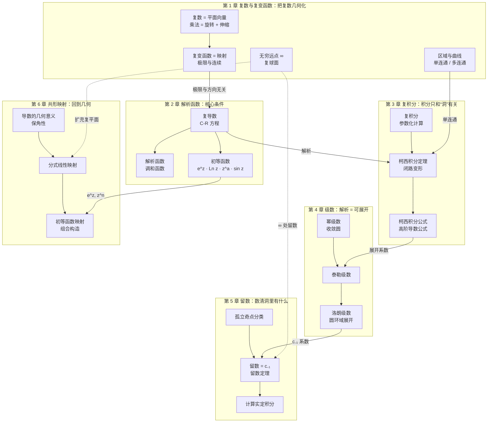

# 前言：复变函数从零到精通

**这是什么。** 一份面向电子信息类本科生的复变函数讲义，覆盖华中科技大学《复变函数与积分变换》课程的**复变函数部分（第 1–6 章）**：复数与复变函数、解析函数、复积分、级数、留数、共形映射。积分变换（傅里叶、拉普拉斯）不在本站范围内。

**先修知识。** 高等数学（极限、偏导数、二重积分、曲线积分、级数）。**不需要**任何复变函数基础——第 1 章从“复数是什么”讲起。

**读完你应当能够：**

1. 把复数、复变函数**看成几何对象**（箭头、旋转、平面到平面的映射），而不只是符号运算；
2. 熟练判断解析性（C-R 方程），会算初等复变函数（指数、对数、幂、三角）；
3. 用柯西积分定理 / 柯西积分公式 / 留数定理计算闭路积分和实定积分；
4. 把函数展开成泰勒级数和洛朗级数，并判断孤立奇点的类型；
5. 用分式线性映射和初等函数构造共形映射，求象区域——这些正是期末考试的主力题型。

## 课程知识地图

整门课其实是一条主线：**“可导（解析）”这一个条件，在复数世界里威力大得惊人**。下面这张图把六章串起来（箭头表示“为……提供工具 / 是……的前提”）：

!!! info "一句话串起整门课"

    第 1 章把复数“几何化”；第 2 章给出“解析”这个核心条件；第 3 章发现解析函数的闭路积分只和**洞（奇点）**有关；第 4 章把解析函数写成级数，洛朗级数的 $c_{-1}$ 系数就是第 5 章的**留数**；第 6 章再回到几何：解析函数（导数非零处）就是**保角映射**。

## 为什么电子类专业要学复变？

| 你以后会遇到的 | 用到的复变知识 |
|---|---|
| 正弦稳态电路的相量法 $\dot U = U e^{j\varphi}$ | 第 1 章：复数的指数形式、乘法 = 旋转 |
| 傅里叶 / 拉普拉斯变换、系统函数 $H(s)$ | 第 2 章 $e^z$；第 5 章用留数求反变换 |
| 极点、零点决定系统稳定性；奈奎斯特判据 | 第 3 章辐角原理（柯西积分）、第 5 章 |
| Z 变换反变换 | 第 4 章洛朗级数、第 5 章留数 |
| 静电场、二维电磁场边值问题、Smith 圆图 | 第 2 章调和函数、第 6 章共形映射（分式线性映射） |

## 这份讲义怎么读

每一节都按同一个顺序展开：**直觉（几何图像）→ 定义与定理 → 手算例题 → 易错点**，章末有**知识点归纳总结**和**练习题（答案可折叠）**。关键处直接在正文中嵌入 manim 动画，边读边看。

**几种彩色框的含义。**

!!! tip "本章目标"

    每章开头：读完本章你应当掌握什么。

!!! info "直觉"

    先用几何图像建立直觉，再看严格定义。

!!! definition "定义"

    严格的数学定义，按章编号（如定义 5.1）。

!!! theorem "定理"

    定理、引理、推论，按章编号；重要的给出证明。

!!! proof "证明"

    定理的证明，可以先跳过、学完例题再回来看。

!!! success "关键公式"

    需要记住的公式和结论。

!!! example "例题"

    带具体数字、可以用笔算的例题。建议先自己做一遍再看解答。

!!! warning "易错点"

    初学者和考试中最容易错的地方。

!!! note "前后联系"

    这个知识点在后面哪一章会再次用到。

!!! abstract "知识点归纳总结"

    每章结尾的要点回顾。

## 进度

| 章 | 内容 | 状态 |
|---|---|---|
| 第 1 章 | 复数与复变函数 | ✅ 已完成（5 段动画） |
| 第 2 章 | 解析函数 | ✅ 已完成（4 段动画） |
| 第 3 章 | 复变函数的积分 | ✅ 已完成（3 段动画） |
| 第 4 章 | 解析函数的级数表示 | ✅ 已完成（3 段动画） |
| 第 5 章 | 留数及其应用 | ✅ 已完成（4 段动画） |
| 第 6 章 | 共形映射 | ✅ 已完成（4 段动画） |
| 总结 | [全课程总结](summary.md)：主线、题型速查、后续课程联系、自测清单 | ✅ |

> **符号约定。** 数学课里虚数单位写作 $i$，电路课里写作 $j$（避免与电流 $i$ 混淆），两者完全是同一个东西。本站正文统一用 $i$。

> **资料来源。** 内容组织参考华中科技大学《复变函数与积分变换》课程 PPT 与配套教材（见「[参考资料与致谢](references.md)」），讲解、例题解答、图和动画均为本站重新编写制作，未转载原 PPT / PDF。
