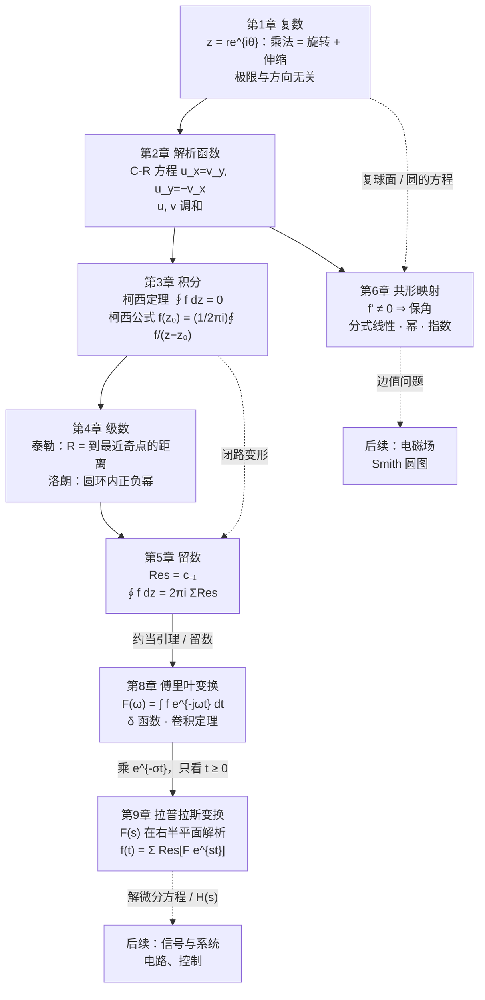

# 全课程总结：一条主线串起全书

复变函数的六章看起来各自独立：复数、导数、积分、级数、留数、映射。其实它们都来自**同一个条件**，即复导数

$$f'(z_0)=\lim_{\Delta z\to0}\frac{f(z_0+\Delta z)-f(z_0)}{\Delta z}$$

与 $\Delta z$ 趋于零的**方向无关**。积分变换两章（第 8、9 章）则把这些工具用在信号上：把信号拆成 $e^{j\omega t}$ 或 $e^{st}$ 的叠加，逆变换又回到留数。本页把这条主线完整地走一遍，再按期末题型整理方法。

---

## 1. 知识地图

## 2. 主线：从“方向无关”到“只看奇点”，再到积分变换

| 步骤 | 内容 | 在哪一章 |
|---|---|---|
| ① | 复数乘法是旋转 + 伸缩；复极限要求从所有方向逼近得到同一个值 | 第 1 章 |
| ② | 把 ① 用在差商上：沿实轴、沿虚轴的极限必须相同 ⇒ **C-R 方程**；几何上，局部线性化必须是“乘以一个复数” | 第 2 章 |
| ③ | C-R 方程 + 格林公式 ⇒ 单连通域内 $\oint f\,\mathrm dz=0$（**柯西定理**）；回路可以随意变形，只要不越过奇点 | 第 3 章 |
| ④ | 把回路缩成绕 $z_0$ 的小圆 ⇒ **柯西积分公式**；对它求导 ⇒ 解析函数**无穷次可导** | 第 3 章 |
| ⑤ | 把柯西核 $\frac{1}{\zeta-z}$ 展成几何级数 ⇒ **泰勒级数**，收敛半径由奇点决定；圆环内 ⇒ **洛朗级数** | 第 4 章 |
| ⑥ | 洛朗级数逐项积分，只有 $c_{-1}$ 项留下 $2\pi i\,c_{-1}$ ⇒ **留数定理**；闭路积分、某些实积分都归结为求留数 | 第 5 章 |
| ⑦ | 回到 ②：$f'(z_0)\ne0$ 时局部是旋转 + 伸缩 ⇒ **保角**；用分式线性映射和初等函数构造区域之间的共形映射 | 第 6 章 |
| ⑧ | 周期 $T\to\infty$，傅里叶级数变成傅里叶积分；$F(\omega)=\int f e^{-j\omega t}\,\mathrm dt$。求导变乘 $j\omega$，卷积变乘积；$\delta$ 函数让常数、正弦也有变换；逆变换是约当引理型积分 | 第 8 章 |
| ⑨ | 乘衰减因子 $e^{-\sigma t}$ 并只看 $t\ge0$，得到拉普拉斯变换，$F(s)$ 在右半平面内解析；反演积分补左半大圆弧，$f(t)=\sum\operatorname{Res}[F(s)e^{st},s_k]$；微分方程变代数方程 | 第 9 章 |

**一句话。** 解析函数在局部只做旋转和伸缩（② ⑦），整体性质完全由**奇点**决定：积分（③ ⑥）、级数的收敛范围（⑤）、留数（⑥），以及逆变换得到的信号的形状（⑧ ⑨：极点位置决定衰减还是增长、振荡多快）。

## 3. 反复出现的几个“老朋友”

| 对象 | 出现的地方 |
|---|---|
| $\dfrac{1}{1-z}=\sum z^n$ | 第 3 章柯西公式的证明；第 4 章泰勒定理与洛朗定理的证明、所有有理函数展开；第 5 章求留数 |
| $\displaystyle\oint\frac{\mathrm dz}{z-z_0}=2\pi i$ | 例题 3.2 → 闭路变形 → 柯西积分公式 → 洛朗系数 $c_{-1}$ → 留数定理 |
| $w=z^2$ | 第 1 章映射动画 → 第 2 章 C-R 与调和函数等值线 → 第 6 章保角性与幂函数映射 |
| $e^z$ | 第 1 章欧拉公式 → 第 2 章周期性与映射 → 第 4 章 $R=\infty$ → 第 5 章约当引理中的 $e^{iaz}$ → 第 6 章带形 → 角形 → 第 8、9 章的核 $e^{-j\omega t}$、$e^{-st}$ |
| $\operatorname{Ln}z$ | 第 2 章多值性与支割线 → 第 3 章“$\frac1z$ 在去心平面内没有单值原函数” → 第 4 章 $\ln(1+z)$ 展开 → 第 6 章角形 → 带形 |
| 圆的方程 $Az\bar z+\bar\beta z+\beta\bar z+C=0$ | 第 1 章 → 第 6 章保圆性的证明 |
| 刘维尔定理 | 第 3 章 → 代数基本定理 → 第 6 章“全平面不能共形映为单位圆” |

## 4. 期末题型与方法速查

| 题型 | 方法要点 | 详见 |
|---|---|---|
| 判断可导、解析，求导数 | 写出 $u,v$ → 偏导连续 → 解 C-R → 看点集是否含开集；$f'=u_x+iv_x$ | 2.1 |
| **构造解析函数** | 先验证调和；$f'(z)=u_x-iu_y$（或 $v_y+iv_x$），令 $x=z,y=0$ 后积分；用条件定常数 | 2.2.3 |
| 初等函数求值 | 一律化为 $\operatorname{Ln}$：$a^b=e^{b\operatorname{Ln}a}$，写全 $2k\pi i$ | 2.3 |
| 闭路积分（不用留数） | 柯西定理 / 柯西积分公式 / 高阶导数公式；非解析函数用参数法 | 3.2–3.4 |
| **洛朗展开** | 找奇点、分圆环 → 部分分式 → 凑 $\frac{1}{1-q}$ 且 $\lvert q\rvert<1$ → 写明圆环 | 4.4.3 |
| **留数计算闭路积分** | 内部奇点 → 判类型 → 规则 I/II/III 或洛朗展开 → $2\pi i\sum$；内部太复杂时用 $\infty$ 处的留数 | 5.2 |
| **计算定积分** | $z=e^{i\theta}$（只取圆内、注意 $z=0$）；上半大圆（$\deg Q\ge\deg P+2$）；$e^{iax}$ + 约当引理 | 5.3 |
| **求象区域** | 边界参数化 → 像曲线 → 测试点定侧；分式线性映射用三点定圆 | 6.2、6.3 |
| **构造共形映射** | 交点 → $0,\infty$ 得角形域 → 幂函数得上半平面 → $\frac{\eta-\lambda}{\eta-\bar\lambda}$ 得单位圆；带形用 $e^z$ | 6.4.3 |
| 傅里叶变换的概念、$\delta$ 函数 | 按定义分段积分；常数、正弦、阶跃用 $\int e^{-j\omega t}\,\mathrm dt=2\pi\delta(\omega)$；性质：时移、频移（调制）、相似、乘 $t^n$ | 8.1–8.3 |
| 卷积 | 画图定积分区间分段计算；或用卷积定理变成乘积 | 8.3.2 |
| **拉普拉斯变换解常微分方程（组）** | 两边取 $\mathcal L$ 代入初值 → 解出 $Y(s)$ → 部分分式或留数求 $\mathcal L^{-1}$ | 第 9 章 |

## 5. 在后续课程与工程中的应用

| 后续课程中的内容 | 用到的复变知识 |
|---|---|
| 正弦稳态电路的相量 $\dot U=Ue^{j\varphi}$、阻抗 $Z=R+jX$ | 复数的指数形式；乘法 = 旋转 + 伸缩（第 1 章） |
| 频谱分析、调制、滤波 $Y(\omega)=H(\omega)X(\omega)$ | 傅里叶变换的频移性质与卷积定理（第 8 章）；$e^{j\omega t}$ 是旋转向量（第 1、2 章） |
| 拉普拉斯反变换 $f(t)=\frac{1}{2\pi j}\int_{\beta-j\infty}^{\beta+j\infty}F(s)e^{st}\,\mathrm ds$ | 补大圆弧 + 约当引理 + 留数定理：$f(t)=\sum\operatorname{Res}[F(s)e^{st},s_k]$（第 5 章、第 9 章） |
| Z 变换及其反变换 | $X(z)=\sum x[n]z^{-n}$ 是洛朗级数，收敛域是圆环（第 4 章）；反变换 $x[n]=\frac{1}{2\pi j}\oint X(z)z^{n-1}\,\mathrm dz$（第 5 章） |
| 系统函数的零极点、稳定性、奈奎斯特判据 | 零点与极点（5.1）；辐角原理是留数定理应用于 $\frac{f'}{f}$ 的结果 |
| 二维静电场、传输线截面的电容 | 解析函数的实部、虚部是调和函数，等势线与电力线正交（第 2 章）；共形映射把复杂边界变成简单边界（第 6 章） |
| Smith 圆图 $\Gamma=\frac{z-1}{z+1}$ | 分式线性映射：右半平面（$\operatorname{Re}z>0$ 的归一化阻抗）映为单位圆盘，等电阻线、等电抗线映为两族正交圆（第 6 章，与动画 6-3 同理） |

## 6. 自测清单

读完全书后，下面每一条你都应该能在一两分钟内答出或写出：

- [ ] 把 $-1+\sqrt3i$ 写成指数形式，求它的立方根；
- [ ] 说明 $\bar z$ 为什么处处不可导；写出 C-R 方程；
- [ ] 已知 $u=x^2-y^2+xy$，求解析函数 $f$，使 $f(i)=-1+i$；
- [ ] 求 $\operatorname{Ln}(-1)$ 与 $i^i$ 的全部值；
- [ ] 默写柯西积分公式与高阶导数公式；计算 $\oint_{|z|=2}\frac{e^z}{(z-1)^3}\,\mathrm dz$；
- [ ] 说出 $\frac{1}{1+x^2}$ 的麦克劳林级数为什么只在 $\lvert x\rvert<1$ 收敛；
- [ ] 把 $\frac{1}{(z-1)(z-2)}$ 在 $1<\lvert z\rvert<2$ 内展开；
- [ ] 写出 $m$ 阶极点的留数公式；说明 $\operatorname{Res}[f,\infty]$ 的定义与符号；
- [ ] 计算 $\int_0^{2\pi}\frac{\mathrm d\theta}{2+\cos\theta}$ 与 $\int_{-\infty}^{\infty}\frac{\cos x}{x^2+1}\,\mathrm dx$；
- [ ] 写出把上半平面映为单位圆盘的一般形式，并解释 $\bar\lambda$ 的来历；
- [ ] 构造把上半单位圆盘映为单位圆盘的共形映射；
- [ ] 求矩形脉冲与 $e^{-\beta|t|}$ 的傅里叶变换；写出 $\delta$ 函数的筛选性质，求 $\mathcal F[\cos\omega_0t]$ 与 $\mathcal F[u(t)]$；
- [ ] 计算 $e^{-\alpha t}u(t)*e^{-\beta t}u(t)$，并用卷积定理验证；
- [ ] 用拉普拉斯变换解 $y''+\omega^2y=0$，$y(0)=0$，$y'(0)=\omega$。

（对应位置依次为：例题 1.7；2.1 节；第 2 章练习 3；例题 2.8、2.10；3.4 节（答案 $\pi i e$）；4.3 节；例题 4.12；5.2 节；第 5 章练习 7 与例题 5.12（全实轴上的积分等于 (1) 的两倍）；定理 6.11；例题 6.9；例题 8.2、8.5、8.6、8.7；例题 8.12；第 9 章 9.4.1 节“求解常微分方程（组）”（答案 $y=\sin\omega t$）。）
